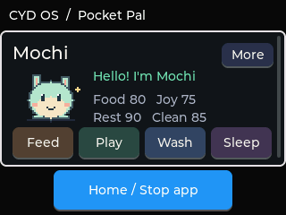

# Pocket Pal

A small, gentle virtual pet for **CYDOS 0.4.0+**. Feed it, keep it clean, let it
nap, and play a three-star touchscreen game. Its expression changes when hungry,
bored, dirty, tired, asleep or under the weather. There is no death mechanic,
network dependency, account, advertising or purchase system.

This is a **separate Lua application**, not an OS firmware modification.
Its standalone source and downloads live on the `apps/pocket-pal` branch; the
firmware branches are unchanged. It uses
the public UI, timer, JSON, resource and private SD storage APIs. Its package
requests **storage only**, and targets both `esp32c5` and `esp32s3`.



## Install from an iPad

1. Run CYDOS **0.4.0 or newer** on the board, with a working SD card.
2. Download [pocket-pal-0.1.0.cydapp](dist/pocket-pal-0.1.0.cydapp) to Files.
3. Join CYDAP or the board's LAN and open its existing authenticated dashboard.
4. Use the **Apps/package uploader**, choose the `.cydapp`, and review the
   `org.cyd.pocketpal` identity and **storage** permission before installing.
5. Open **Pocket Pal** under Apps. Use Feed, Play, Wash and Sleep/Wake.
   More shows live need bars and lets you rename the pet.

The app package is **not** an OS update: do not put it into the firmware uploader.
No USB flashing is needed to install this app on a compatible running OS.
On an older OS it displays an upgrade message instead of starting the game.

## Care and saving

- Needs change every minute **while the app is running**. Naps restore energy;
  care and play have small tradeoffs. An exhausted pal automatically falls asleep.
- Health recovers when its needs are met. Even at zero health it can recover.
- Growth is based on active time: Baby, Buddy after 30 minutes, Grown-up after
  two hours. The sprite remains the same creature; growth changes the age label.
- Closing the app or turning the device off pauses it. No clock API or background
  runtime is assumed. It does not punish you for leaving the app closed.
- Progress saves immediately after successful care, game catches and renaming,
  and every 30 seconds while running. Home/Stop can lose up to the last 30 seconds
  of passive time; there is no app shutdown callback.
- The two alternating JSON checkpoints are in the OS's app-private SD directory,
  `/sdcard/cydos/data/org.cyd.pocketpal/`. A bounded checksum and field validation
  allow fallback if one save is damaged. Both damaged/missing saves start a new
  pet. These are ordinary SD files, not encrypted or protected from physical edits.
- An absent, full or failing SD can stop the app with the OS storage error. The
  application cannot catch storage exceptions in the restricted API. Back up both
  checkpoint files if the pet matters to you. A hardware power-loss test is pending.
- Timer catch-up is capped at five minutes after a stalled callback. Long native
  stalls do not cause a large catch-up loop or an instant pet crisis.

## Compatibility

The same `.cydapp` supports C5 landscape **320×240**, portrait **240×320**, and the
existing CrowPanel S3 **800×480** profile. It measures the usable app area, keeps
the OS-owned Home/Stop visible, and uses two rows of care buttons on narrow screens.

OS firmware is board-specific. The CYDOS S3 profile is for the **Elecrow CrowPanel
Advance 4.3-inch DIS01943A V1.1–V1.3** with RGB display/GT911 touch. Other Elecrow
boards and V1.0 are not implied compatible. Never flash the C5 OS image to an S3.
Physical board/revision and hardware acceptance must be checked separately.

## Source and reproducible build

`src/model.lua` is the pure care/save model; `src/ui.lua` is the UI. The build
concatenates these into `app/main.lua` because the sandbox has no module loader.
Sprites are original procedural pixel art generated by `tools/make_sprites.py`.
All nine images use the public bounded CIMG RGB565 format, 80×64 pixels each.

With a CYDOS 0.4 source checkout:

```sh
python tools/build.py --cydos /path/to/CYD-OS
python /path/to/CYD-OS/tools/cydctl/cydctl.py inspect dist/pocket-pal-0.1.0.cydapp --json
```

The builder calls the existing host packager/validator and keeps ZIP_STORED,
512 KiB/package, 48 files and 64 KiB/file constraints. `app/` is a normal CYDOS
source folder and can also be packaged directly after generating `main.lua`.
The release package and its SHA-256 are in `dist/`.

## Test

The host tests need an activated ESP-IDF checkout for cJSON, C compiler and CMake.
Configure the pinned LVGL dependency in the OS checkout first. No firmware source
or device settings are changed by these tests.

```sh
export CYDOS_SOURCE=/path/to/CYD-OS
cmake -S tests/host -B build-host -DCYDOS_SOURCE="$CYDOS_SOURCE"
cmake --build build-host --parallel 4
python -m unittest discover -s tests -v
```

The actual pinned Lua/LVGL and CYDOS runtime are linked under ASan/UBSan. RTOS,
network transport and filesystem are explicit host fixtures. See [VALIDATION.md](VALIDATION.md)
for exact results; previews are host renders, not photos of a working device.
